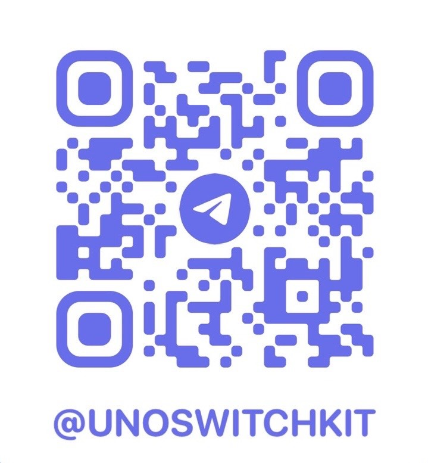

# SwitchKit

Mac 菜单栏快捷开关 + 系统资源释放工具。macOS 专属、常驻菜单栏、体积极小（目标：安装包 < 15MB、常驻内存 < 50MB）。

## 技术栈

| 层 | 选型 |
|---|---|
| 桌面壳 | Tauri 2.0（Rust） |
| 前端面板 | React 18 + TypeScript + Tailwind + Vite |
| 原生补充 | Swift sidecar daemon（蓝牙 / 前台监听） |
| 特权执行 | `osascript` 密码框（MVP）→ `SMJobBless` helper（生产） |
| 持久化 | JSON 文件（AppConfig 目录，MVP 简化） |

## 功能

- **快捷开关（FR-2 P0）**：深色模式、隐藏桌面图标、阻止睡眠（caffeinate）、清空废纸篓、隐藏 Dock、显示隐藏文件、屏幕清洁（一键收起/恢复全部前台窗口）、台前调度（仅 macOS 13+ 显示）。
- **即时动作**：锁定屏幕、清空剪贴板、启动屏幕保护、关闭所有应用（优雅退出，跳过自身与 Finder）。
- **蓝牙设备**：列出已配对设备，一键连接 / 断开（系统框架 IOBluetooth，经 Swift 守护，无第三方依赖）。
- **资源释放（FR-3 P0）**：释放内存（`purge`，需 root）、刷新 DNS（`dscacheutil`/`mDNSResponder`，需 root）、清理用户缓存（白名单 + 预览 + 二次确认）。
- **开机自启（FR-4）**：注册/移除 `~/Library/LaunchAgents/com.switchkit.app.plist`（单实例保护，不会出现双图标）。
- **在线更新**：基于 `tauri-plugin-updater`，面板「检查更新」按钮可一键下载安装并重启。当前未配置更新服务器，按钮显示「更新服务尚未配置」；接入服务器只需在构建期导出 `SWITCHKIT_UPDATE_ENDPOINTS`（详见构建指南 §6.6）。
- **模型余额（FR-8）**：多平台、多账号混排展示余额，60 秒自动刷新。支持 DeepSeek、Kimi（国内/国际）、智谱 GLM、阶跃星辰、Novita AI、OpenRouter、302.AI、AiHubMix，以及中转站自定义（OpenAI 计费接口 / new-api user quota）。可选 HTTP 代理，面板不展示明文 Key。
- **状态实时反映（FR-7）**：面板打开即读取系统真实状态，避免与系统设置不同步。
- **Swift sidecar（M4）**：本地 `127.0.0.1:9876` 承载蓝牙设备管理与开关。

## 安装

### 系统要求

- macOS 10.14+（主程序与 Swift sidecar 均按 10.14 部署目标编译，分发包为 universal 通用二进制，同时支持 Apple Silicon 与 Intel；台前调度开关仅 macOS 13+ 显示，其余功能不受影响）
- Apple Silicon / Intel 均可，分发包必须是 universal 二进制。`npm run tauri build` 只出当前架构，**分发请用 `./scripts/build-release.sh`**（默认 universal）；单架构包在另一种芯片上会弹「需要安装 Rosetta」

### 从分发包安装

1. **下载**。前往 [GitHub Release](https://github.com/samjoeyang/unoSwitchKit/releases)（或官网下载页）下载对应芯片的压缩包：Apple 芯片选 `arm64`、Intel 选 `x86_64`、不确定选 `universal`。

2. **解压并拖入应用程序**。若拿到的是分卷（`*.z01`、`*.z02` … `*.zip`），先合并再解压：

   ```bash
   zip -s 0 SwitchKit-v0.4.1-universal.zip --out SwitchKit-full.zip
   unzip SwitchKit-full.zip     # 得到 SwitchKit.app
   ```

   单卷直接 `unzip SwitchKit-*.zip`。不要用第三方解压工具解分卷，容易丢 `.app` 包裹层。得到 `SwitchKit.app` 后，把它拖进 `/Applications`（「应用程序」文件夹，不要在压缩包内直接双击运行）。

3. **首次启动**。打开「应用程序」文件夹，**直接点 SwitchKit 图标打开**（无需在 Finder 里右键）。分发包为 ad-hoc 签名、未公证，macOS 会先弹出安全警告，按下面顺序放行即可（只需一次）：

   - 双击打开后弹「未打开"SwitchKit"」→ 点「完成」关掉；
   - 打开「系统设置 → 隐私与安全性」，底部点「仍要打开」；
   - 再次确认弹窗点「仍要打开」；
   - 用触控 ID / 管理员密码授权，App 随即启动。
   - 若仍提示「已损坏，无法打开」，先移除隔离属性再重试：

     ```bash
     xattr -dr com.apple.quarantine /Applications/SwitchKit.app
     ```

4. 启动后**无 Dock 图标**，图标常驻菜单栏；点击菜单栏图标展开面板。

### 首次运行需授予的权限

| 权限 | 授予位置 | 用途 | 不授予的后果 |
|---|---|---|---|
| 自动化（Finder） | 系统设置 → 隐私与安全性 → 自动化 | 清空废纸篓、关闭所有应用 | 这两个操作报错 |
| 完全磁盘访问权限 | 隐私与安全性 → 完全磁盘访问权限 | 清理 Safari 等受 TCC 保护的缓存 | 该目录被跳过，其余目录照常清理 |
| 蓝牙 | 首次扫描设备时系统弹窗 | 列出 / 连接蓝牙设备 | 蓝牙模块列表为空 |
| 管理员密码 | 操作时系统密码框 | 释放内存（`purge`）、刷新 DNS | 每次操作都需输入密码（凭据不落盘） |

完全磁盘访问需要**授权后重启 App**才生效。

> 可选依赖：蓝牙设备列表 / 连接走系统 `IOBluetooth`，无需额外安装；只有「蓝牙整机开关」需要 `brew install blueutil`。

### 开机自启

设置（齿轮）→ 开机启动。开启后写入 `~/Library/LaunchAgents/com.switchkit.app.plist`，自带单实例保护，不会出现双图标。

### 在线更新

设置 → 检查更新。若构建时未配置更新服务器，会提示「更新服务尚未配置」；配置方法见 [docs/构建指南.md](docs/构建指南.md) §6.6。

### 卸载

```bash
# 1. 先在 App 内关闭「开机启动」，然后退出 App
launchctl unload ~/Library/LaunchAgents/com.switchkit.app.plist 2>/dev/null
rm -f ~/Library/LaunchAgents/com.switchkit.app.plist
# 2. 删除应用
rm -rf /Applications/SwitchKit.app
# 3. 可选：清除配置与已保存的 Key
rm -rf ~/Library/Application\ Support/com.switchkit.app
```

## 目录结构

```
unoSwitchKit/
├── src/                     # React 前端面板
│   ├── App.tsx
│   ├── components/          # ToggleGrid / ResourcePanel / StatusDot
│   ├── ipc.ts               # 封装 Tauri invoke
│   └── types.ts
├── src-tauri/
│   ├── src/
│   │   ├── main.rs          # 入口：窗口/托盘/状态/命令注册
│   │   ├── tray.rs          # 托盘 + 面板定位
│   │   ├── commands.rs      # 所有开关/释放命令
│   │   ├── privilege.rs     # root 提升通道（osascript 密码框）
│   │   ├── cache_whitelist.rs # 缓存清理白名单 + 主目录限制
│   │   ├── store.rs         # 设置持久化 + 开机自启
│   │   ├── models.rs        # 结构化返回类型
│   │   └── util.rs          # shell/osascript 封装
│   ├── swift/               # Swift sidecar（M4）
│   ├── icons/               # 应用图标（已生成）
│   ├── capabilities/        # 权限声明
│   ├── Cargo.toml
│   ├── tauri.conf.json      # activationPolicy: accessory
│   └── build.rs
├── docs/                    # 需求文档 / 设计文档 / 构建指南
└── package.json
```

## 开发 / 构建

详见 [docs/构建指南.md](docs/构建指南.md)。快速开始：

```bash
# 1. 安装 Rust（含 stable + 双架构 target）
curl --proto '=https' --tlsv1.2 -sSf https://sh.rustup.rs | sh
rustup target add aarch64-apple-darwin x86_64-apple-darwin

# 2. 安装前端依赖
npm install

# 3. 开发模式（前端热更新 + Rust 重新编译）
npm run tauri dev

# 4. 生产构建（universal-apple-darwin）
npm run tauri build
```

> 本仓库已在本机（macOS 12.7.6 / Rust 1.99）通过 `cargo check` 验证后端可编译；前端 `npm run build` 通过 `tsc` 类型检查。完整 GUI 运行需在 macOS 13+ 实体机。

## 安全设计（NFR-3 / NFR-4）

- 缓存/文件删除**仅允许白名单目录**，且限制在主目录 `~` 内，拒绝任何越权绝对路径。
- 破坏性操作（清缓存 / 释放内存）前端走「预览 → 二次确认」流程。
- root 操作经特权通道，凭据不落盘、不进日志、不硬编码。
- 不调用私有 AppKit API；默认不联网、不上报。

## 已知约束

- 最低系统版本定为 `10.14`：`minimumSystemVersion` 受 Swift 守护依赖的 Network 框架（macOS 10.14+）限制，不能下调到 10.13；分发包为 universal 通用二进制，同时支持 Apple Silicon 与 Intel 芯片。
- 蓝牙开关依赖第三方 `blueutil`（需 `brew install blueutil`），Swift sidecar 才会真正生效。

## 讨论群组与赞赏

### 交流群组

遇到问题、提建议、看更新动态，来 Telegram 群组找我们。扫码或搜索 **[@UNOSWITCHKIT](https://t.me/UNOSWITCHKIT)** 即可加入。



### 赞赏支持

SwitchKit 完全免费、无广告、不收集数据。若它让你的 Mac 更好用，欢迎赞助，支持持续开发。

| 微信支付 | 支付宝 |
|---|---|
|  |  |

收款方式以二维码为准。
