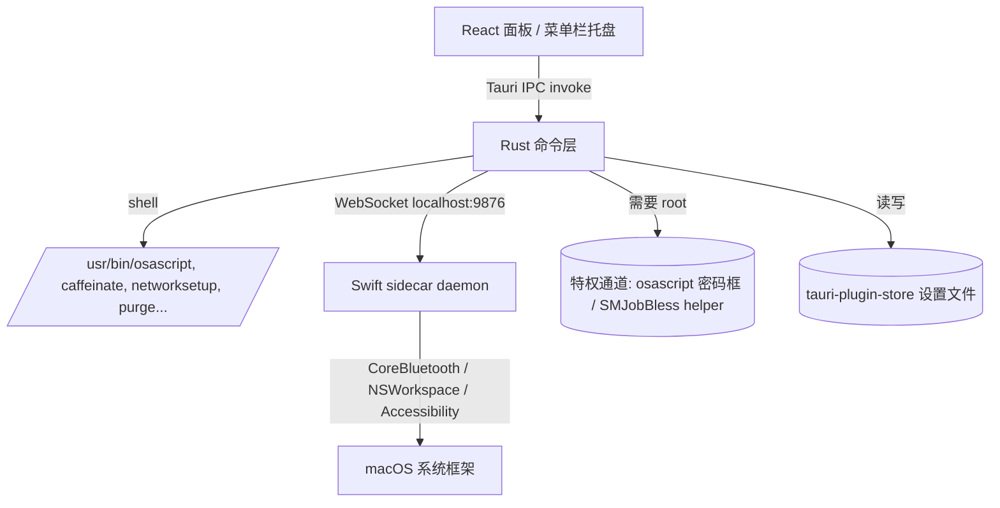
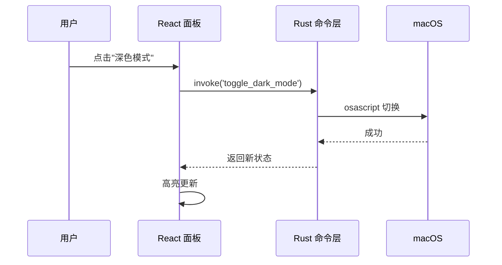
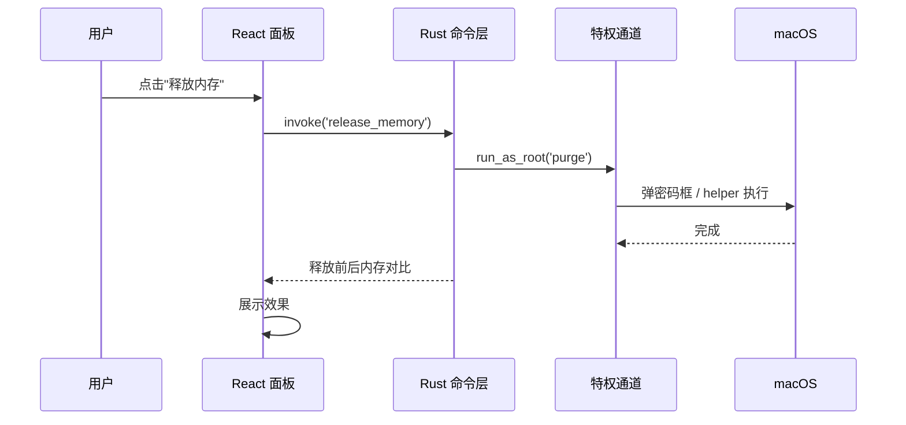

# 设计文档（TDD）—— Mac 菜单栏快捷开关 + 系统资源释放工具

> 项目名：SwitchKit ｜ 工程目录：`unoSwitchKit`
> 文档版本：v0.1 / 2026-10-30

---

## 1. 技术栈

| 层 | 选型 | 说明 |
|---|---|---|
| 桌面壳 | **Tauri 2.0**（Rust） | 托盘、窗口、IPC、打包 |
| 前端面板 | React 19 + TypeScript + Tailwind | 无边框面板 UI，复用现有 Web 技能 |
| 原生补充 | **Swift sidecar daemon** | 蓝牙、NSWorkspace 监听、Accessibility 等 Web 触及不到的能力 |
| 特权执行 | `osascript` 密码框（MVP）→ `SMJobBless` helper（生产） | 释放内存、刷新 DNS |
| 持久化 | `tauri-plugin-store` | 设置与状态 |
| 构建 | `tauri build` + `tauri-plugin-updater`（Sparkle） | 打包、公证、自动更新 |

**为何 Tauri 而非 Electron**：常驻内存 30–40MB（Electron 150–400MB），安装包 < 10MB，使用系统 WebView 不打包 Chromium，规避私有 API 全局卡顿风险。

---

## 2. 架构



- **前端** 只负责渲染与发命令，不直接碰系统 API。
- **Rust 命令层** 是唯一调用外部命令的边界，便于审计与加白名单。
- **Swift sidecar** 独立进程，经 localhost WebSocket 与 Rust 通信（参考 Tauri + Swift daemon 实践），承载纯 Web 无法完成的原生能力。

---

## 3. 目录结构（目标）

```
unoSwitchKit/
├── src/                      # React 前端
│   ├── App.tsx
│   ├── components/
│   │   ├── ToggleGrid.tsx    # 快捷开关网格
│   │   ├── ResourcePanel.tsx # 资源释放区
│   │   └── StatusDot.tsx
│   └── ipc.ts                # 封装 invoke 调用
├── src-tauri/
│   ├── src/
│   │   ├── main.rs
│   │   ├── tray.rs           # 托盘 + 无边框面板定位
│   │   ├── commands.rs       # Rust 命令（开关/释放）
│   │   ├── privilege.rs      # root 提升通道
│   │   ├── cache_whitelist.rs# 缓存清理白名单
│   │   └── store.rs          # 设置持久化
│   ├── swift/                # Swift sidecar
│   │   ├── daemon.swift      # 蓝牙/监听
│   │   └── bridge.swift      # WebSocket server
│   ├── capabilities/         # 权限声明
│   ├── tauri.conf.json       # macOS activationPolicy: accessory
│   └── Info.plist
├── docs/
│   ├── 需求文档.md
│   └── 设计文档.md
└── package.json
```

---

## 4. 模块设计

### 4.1 菜单栏与面板（tray.rs + tauri.conf.json）
- `tauri.conf.json` 设 `"macOS": { "activationPolicy": "accessory" }` → 无 Dock、无 App Switcher。
- 用 `TrayIconBuilder` 建托盘图标，左键点击获取 `position`/`size`，将无边框窗口定位到图标正下方居中：
  ```
  x = tray_pos.x + tray_size.width/2 - panel_width/2
  y = tray_pos.y + tray_size.height
  ```
- 面板 `decorations: false`，监听窗口 `blur` 事件自动 `hide()`；调用原生对话框时临时抑制 blur 收起（避免对话框未弹就先隐藏）。

### 4.2 Rust 命令层（commands.rs）
每个开关/释放动作一个 `#[tauri::command]`，前端 `invoke`。示例签名：
```rust
#[tauri::command]
fn toggle_dark_mode() -> Result<bool, String> { /* osascript */ }

#[tauri::command]
fn release_memory() -> Result<MemoryStat, String> { /* 提升权限后 purge */ }
```
- 命令内部统一用 `std::process::Command` 执行 shell 命令，返回结构化结果（成功/失败/当前状态）。
- `caffeinate` 用常驻子进程句柄管理启停（记录 pid，关闭时 kill）。

### 4.3 资源释放引擎（commands.rs + cache_whitelist.rs）
- **释放内存**：`privilege::run_as_root("purge")` → 返回释放前后 `vm_stat` 读数。
- **刷新 DNS**：`privilege::run_as_root("dscacheutil -flushcache; killall -HUP mDNSResponder")`。
- **清理缓存**：遍历 `cache_whitelist.rs` 中的白名单条目（如 `~/Library/Caches/com.apple.Safari`、`~/Library/Caches/Google` 等），统计大小 → 二次确认 → 删除。提供"仅预览"模式只统计不删。
- 所有路径经 `expanduser` 限定在 `~` 内，拒绝绝对越权路径。

### 4.4 Swift sidecar（swift/daemon.swift）
- 编译为独立二进制，随 Tauri 打包（sidecar）。
- 启动本地 WebSocket server（如 `:9876`），Rust 连接后双向通信。
- 职责：蓝牙开关（`IOBluetooth`）、应用前台监听（`NSWorkspace.didActivateApplicationNotification`）、未来 Accessibility 能力。
- MVP 可先不做；先以 `blueutil` CLI 替代蓝牙，把 sidecar 留到 M4。

### 4.5 权限提升通道（privilege.rs）
- **MVP**：`osascript -e 'do shell script "..." with administrator privileges'` 弹系统密码框。
- **生产**：`SMJobBless` 安装 privileged helper（最小权限、仅执行白名单 root 命令），避免每次弹窗、避免密码明文。
- 凭据绝不落盘、不进日志。

### 4.6 持久化（store.rs）
- `tauri-plugin-store` 保存：开关顺序、自启状态、缓存白名单、上次释放结果。
- 路径使用 Tauri 规范 `BaseDirectory::AppConfig`。

---

## 5. 关键流程

### 5.1 开关切换（以深色模式为例）


### 5.2 资源释放（需 root）


---

## 6. UI/UX 设计

- **面板**：宽 ~320px，圆角无边框，毛玻璃背景。
  - 上半：快捷开关网格（图标 + 名称 + 状态点）。
  - 下半：资源释放卡片（释放内存 / 刷新 DNS / 清理缓存，含"释放前→后"数字）。
  - 底部：设置齿轮 + 自启开关。
- **状态指示**：开关开启显示主题色高亮；面板打开即读真实状态，避免与系统不同步。
- **确认**：缓存清理、内存释放等破坏性操作前弹确认（可勾选"不再提示"）。

---

## 7. 安全与权限设计
- 文件操作**白名单 + 主目录限定 + 预览确认**三重防护（NFR-3）。
- 不调用私有 AppKit API。
- root 操作经特权通道，凭据不落盘。
- 默认不联网、不上报。

---

## 8. 构建与分发
- `tauri build --target universal-apple-darwin`（Apple Silicon + Intel）。
- 上架前做 **Apple 公证（notarize）**，否则 Gatekeeper 拦截。
- 自动更新用 `tauri-plugin-updater`（基于 Sparkle）。
- 首版走官网/直链分发，暂不上 App Store（沙盒会限制系统命令）。

---

## 9. 风险与对策
| 风险 | 对策 |
|---|---|
| 私有 API 调用导致系统异常 | 仅用公开 CLI/AppleScript，规避私有 API |
| root 弹窗体验差 | 生产引入 SMJobBless helper，减少弹窗 |
| 多显示器面板定位错误 | 用托盘点击事件的全局坐标 + 屏幕边界计算 |
| 缓存误删 | 白名单 + 预览模式 + 二次确认 |
| 面板 blur 误收起 | 原生对话框期间抑制 blur 收起逻辑 |
| macOS 大版本菜单栏变更 | 锁定最低 Ventura，新版本单独回归 |

---

## 10. 实施进度与偏差（v0.1 → 实现）

> 本节记录 2026-10-30 首轮实施中发现与原始设计（v0.1）的差异，以及里程碑完成情况。
> 权威进度见仓库根 `CHANGELOG.md`，构建步骤见 `docs/构建指南.md`。

### 10.1 里程碑完成度

| 里程碑 | 状态 | 说明 |
|---|---|---|
| M1 菜单栏骨架 | ✅ | Tauri 2.0 + accessory 模式 + 托盘/无边框面板 + 开机自启 |
| M2 FR-2 P0 开关 | ✅ | 深色模式 / 隐藏桌面 / 阻止睡眠 / 清空废纸篓（纯 shell） |
| M3 FR-3 P0 资源释放 | ✅ | 释放内存 / 刷新 DNS（osascript 提权）+ 白名单清缓存 + 前后对比 |
| M4 Swift sidecar + 持久化 | 🟡 | TCP/JSON 守护 + 设置 JSON 持久化 + 面板打磨；待实体机验证 |

### 10.2 相对 v0.1 的偏差

| 原设计 | 实现决定 | 理由 |
|---|---|---|
| 6.6 持久化用 `tauri-plugin-store` | 改用 `std::fs` JSON 文件（AppConfig 目录） | MVP 减少插件依赖与 capability 面，能力等价；后续可平滑替换为插件（`store.rs` 已封装） |
| 2. 架构图 Swift sidecar 走 WebSocket `:9876` | 改用 **TCP + 换行分隔 JSON**（同端口 `:9876`） | 零依赖落地；Rust 侧用 `std::net::TcpStream`，后续可平滑替换为 WebSocket |
| 未指定 `minimumSystemVersion` | 暂设 `10.13` | 开发机为 macOS 12，需可构建；**发布前应上调至 Ventura 13** |
| 1. 前端 React 19 | 采用 React 18.3 | 与 Vite 插件兼容性最佳、最稳定 |
| 菜单栏图标收纳：AX API 逐项移动（Bartender 式白名单巡检） | **改为「分隔条撑开」方案（Hidden Bar 同款）**：守护进程自建「箭头 + 分隔条」状态项，收起时分隔条长度撑到 ~2 倍屏宽把分界线左侧图标挤出屏幕 | **实测定案**：macOS 12 上 AX 写入状态项位置一律返回 `kAXErrorFailure`(-25200)（其它进程/本进程/窗口直移/窗口排序均无效）；Hidden Bar 官方架构文档确认「macOS 无公开 API 可移动其它 App 的菜单栏图标」。v0.3.2 重构，详见 CHANGELOG |

### 10.3 环境约束（实施时实测）

- 开发机：**macOS 12.7.6（Monterey）**，低于 PRD 要求的最低 **Ventura 13**。
- Rust 1.99.1（stable）+ 双架构 target（aarch64 / x86_64）已就绪；`cargo check` 通过。
- Swift 5.7.2（系统自带），sidecar 用 `swiftc -framework AppKit` 编译。
- 后端 `cargo check` 与前端 `tsc` 类型检查均已通过；完整 GUI 运行需在 macOS 13+ 实体机验证（本机无 GUI 显示）。

### 10.4 安全实现要点（对照 NFR-3/NFR-4）

- 缓存删除仅命中 `cache_whitelist.rs` 白名单目录，且经 `is_under_home` 校验限制在主目录内，拒绝越权绝对路径（`clear()` 删除后重建空目录避免依赖崩溃）。
- 破坏性操作由前端走「预览 → `confirm` 二次确认」。
- root 操作经 `privilege::run_as_root`（`osascript … with administrator privileges`），凭据不落盘、不进日志、不硬编码。
- 不调用私有 AppKit API；默认不联网、不上报。
